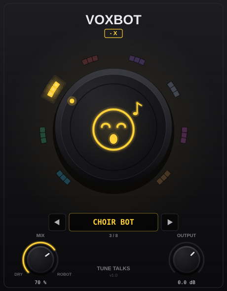
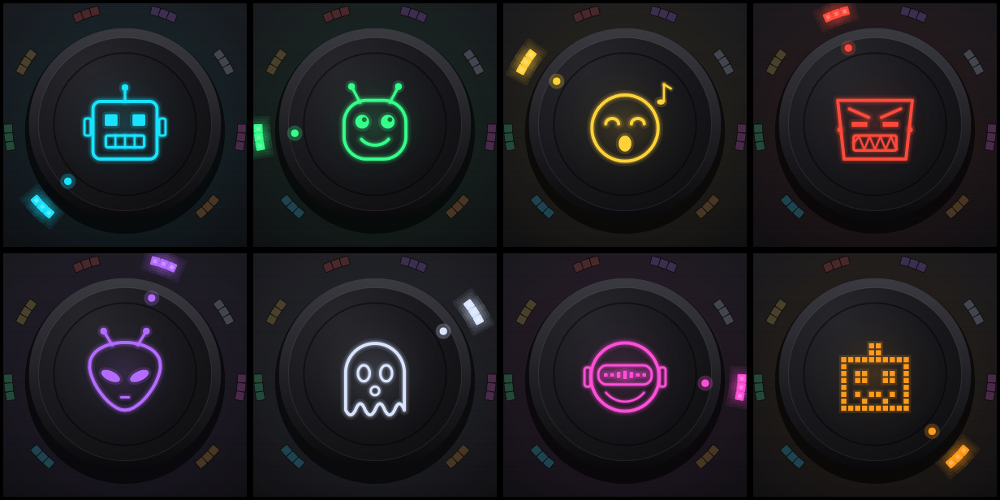

# VoxBot - X — by Tune Talks

Vocoder robotico da inserire direttamente sul canale della voce (VST3 / AU / Standalone).
Non servono MIDI né sidechain: il plugin segue l'intonazione della voce e genera da solo il suono robotico.



## Controlli
| Controllo | Funzione |
|---|---|
| **Knob centrale (faccia robot)** | Sceglie il preset. La faccia e il colore cambiano per ogni robot. Si può anche usare ◀ ▶ sotto il knob. |
| **MIX** (in basso a sinistra) | Bilanciamento tra voce originale (DRY) e voce robot (ROBOT). Crossfade a potenza costante. Doppio clic = 100 %. |
| **OUTPUT** (in basso a destra) | Volume d'uscita, −24 / +12 dB. Doppio clic = 0 dB. |

## Preset


| # | Preset | Suono |
|---|---|---|
| 1 | **ROBOT** | Robot classico su nota fissa (La2): voce monotona |
| 2 | **ANDROID** | Segue l'intonazione della voce: robot "cantante" |
| 3 | **CHOIR BOT** | Accordo (tonica + quinta + ottava), intonazione agganciata ai semitoni |
| 4 | **TITAN** | Un'ottava e due ottave sotto, formanti scure: voce da gigante |
| 5 | **ALIEN** | Un'ottava sopra, formanti piccole, modulazione ad anello |
| 6 | **GHOST** | Portante di rumore: voce sussurrata/spettrale |
| 7 | **DISCO** | Onda quadra agganciata ai semitoni + ottava: stile talk-box french house |
| 8 | **8-BIT** | Onda quadra e riduzione di bit/sample rate: voce da videogioco |

## Come funziona
- **Pitch tracker YIN** che rileva l'intonazione della voce (60 Hz – 1,1 kHz).
- **Portante sintetizzata** (dente di sega, quadra o rumore, fino a 3 voci) che segue la nota rilevata.
- **Vocoder a 20 bande** (110 Hz – 7,8 kHz): l'inviluppo spettrale della voce viene impresso sulla portante; il parametro formant sposta le bande di sintesi per voci più grandi o più piccole.
- Le consonanti (s, t, f) passano in parallelo per mantenere le parole comprensibili; nelle parti non intonate la portante diventa rumore.
- Ingresso mono o stereo, latenza zero, circa 3 % di CPU su un core.

## Installazione (Mac)
Scarica `VoxBot - X Installer.pkg` dalla pagina **Releases** e aprilo (clic destro → Apri la prima volta, perché non è firmato da Apple).

## Compilazione
```bash
cmake -B build -DCMAKE_BUILD_TYPE=Release
cmake --build build --config Release
```
Ogni push su GitHub compila automaticamente Mac (Apple Silicon + Intel) e Windows e aggiorna l'installer `.pkg` nella Release.
